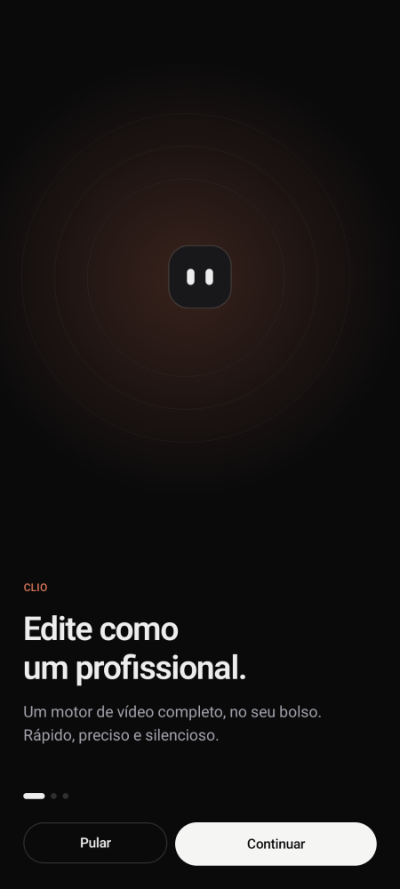
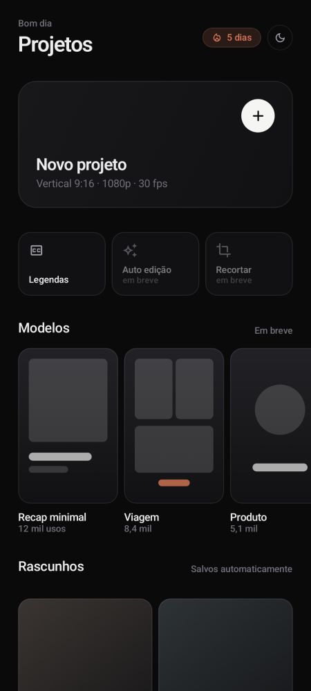
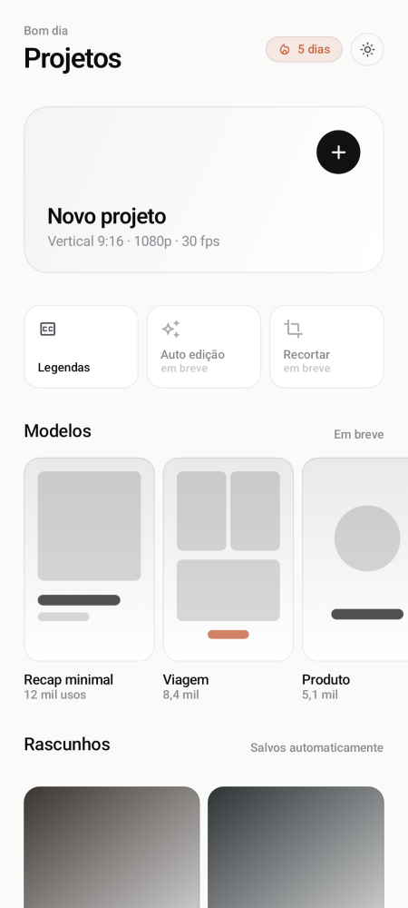
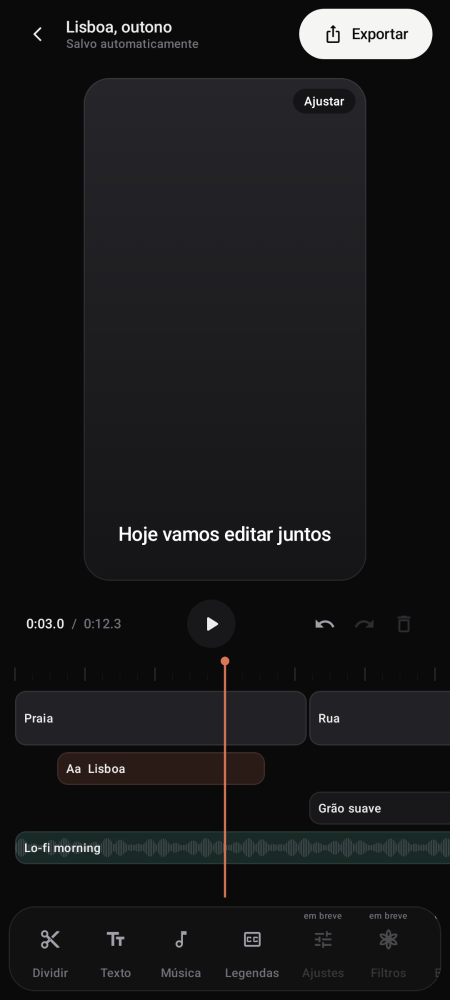
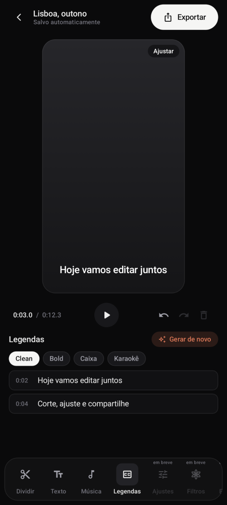
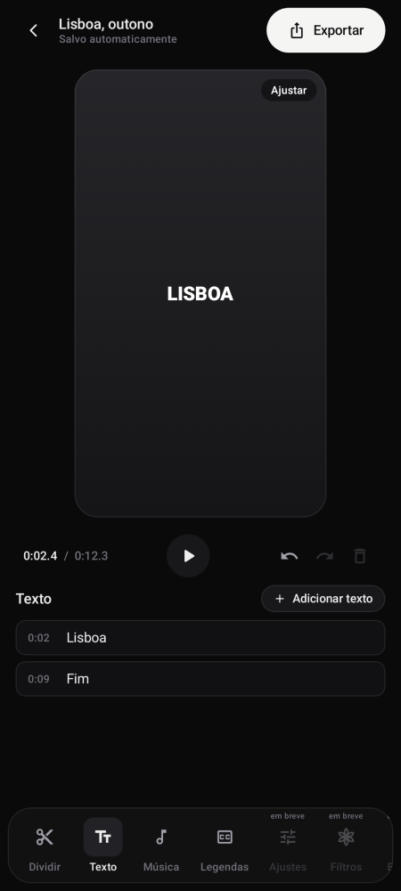

# Clio

**A mobile-first video editor for Android.** Calm, minimal and quick: import, cut, caption,
add text and music, and export, all on the phone.

<p>
  
  
  
  
  
  
  
</p>

## Features

- **Import** videos and photos with the Android Photo Picker. Thumbnails and filmstrips come from the real files.
- **Multi-track timeline**: drag to scrub (with fling), pinch to zoom, split, ripple delete, and undo/redo.
- **Automatic captions on the device**: Whisper runs in the FilmCraft `speech` engine, with Portuguese and other languages. The model downloads on first use and is not bundled. Captions are editable and come in four styles.
- **Text overlays** and **background music**.
- **Export** to MP4 (Reels/TikTok 9:16, square, YouTube 1080p) with captions and text burned in. Files are saved to the gallery under *Movies/Clio*. Media does fit (letterbox) or fill (crop).
- **Drafts autosave** after every edit, written atomically. There is also an onboarding flow and a daily streak.
- **Design**: light and dark themes that follow the system (with a toggle), spring motion and haptics.

## Status

| Area | Implementation |
| --- | --- |
| Timeline model, undo/redo, drafts | Rust (`crates/ffi-mobile`), real |
| Captions (speech-to-text, SRT/VTT) | Rust (`filmcraft-speech` Whisper, `filmcraft-captions`), real |
| Preview playback | Media3 ExoPlayer, interim (engine renderer planned) |
| Export | Media3 Transformer, interim (FilmCraft `render`/`export` planned) |
| Filters, effects, adjustments, speed, templates | Coming soon |

## Repository layout

- `apps/clio-android/`: the Clio app (Kotlin, Jetpack Compose, Material 3)
- `crates/ffi-mobile/`: UniFFI bridge from Clio to the engine
- `crates/*`: the FilmCraft engine crates Clio needs (`project`, `captions`, `speech`, `time`, … and their dependencies)

## Build

Requirements: JDK 17, Android SDK 35, NDK 27.2.12479018, Rust (stable) with
`aarch64-linux-android` and `x86_64-linux-android`, and [`cargo-ndk`](https://github.com/bbqsrc/cargo-ndk).

```sh
cd apps/clio-android
export ANDROID_HOME=~/Android/Sdk ANDROID_NDK_HOME=$ANDROID_HOME/ndk/27.2.12479018
./build-rust.sh            # engine → jniLibs + Kotlin bindings
./gradlew assembleDebug    # app/build/outputs/apk/debug/app-debug.apk
./gradlew verifyPaparazziDebug   # screenshot tests (record: recordPaparazziDebug)
```

The `android` GitHub Actions workflow builds the APK on every PR and uploads it as an artifact.

## Credits and license

Clio is its own project. **Based on FilmCraft by the ArtCraft team.** Clio uses the FilmCraft
engine crates and does not redistribute the FilmCraft applications or any ArtCraft/FilmCraft
branding.

Licensed under either of [Apache License 2.0](LICENSE-APACHE) or [MIT](LICENSE-MIT), at your
option, the same dual license as the engine (FilmCraft copyright retained in both files). See
[NOTICE](NOTICE) and [ATTRIBUTION.md](ATTRIBUTION.md) for third-party attributions. Fonts the
engine bundles (`assets/fonts`) are under the SIL Open Font License; the license texts are next
to them.
